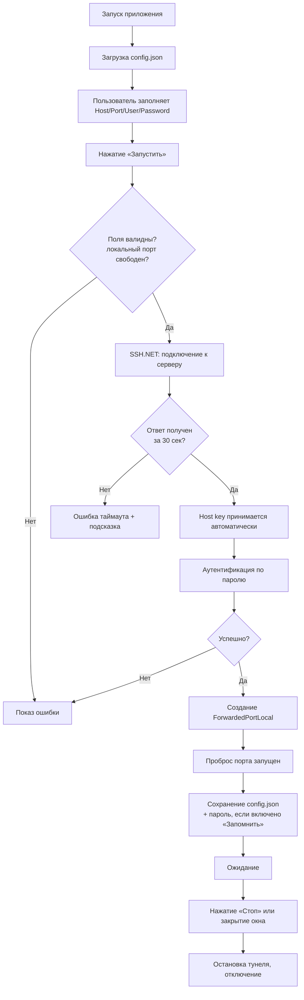
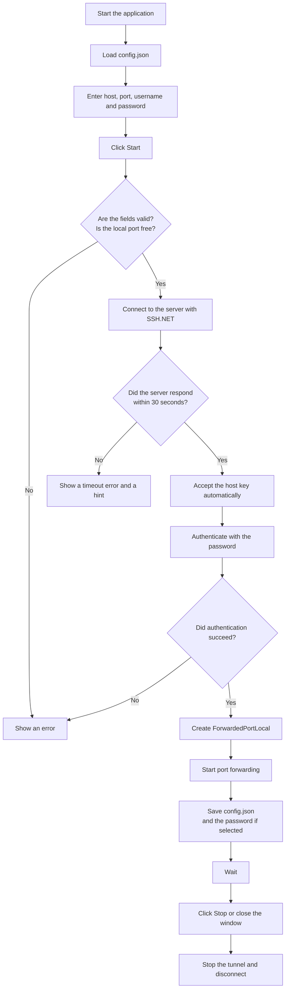

# SSH Tunnel Manager

[Русский](#русский) · [English](#english)

## Русский

[](https://github.com/surikat858/ssh-tunnel-manager/releases)
[](https://github.com/PowerShell/PowerShell)
[](https://opensource.org/licenses/MIT)
[](https://www.microsoft.com/windows)
[](https://github.com/sshnet/SSH.NET)

---

### 📌 О проекте

**SSH Tunnel Manager** – компактное GUI-приложение для Windows для проброса локального порта через SSH (аналог `ssh -L 8080:127.0.0.1:3389 user@host`), без зависимости от `plink.exe`.

Библиотека [SSH.NET](https://github.com/sshnet/SSH.NET) встраивается прямо внутрь `.exe` при сборке — результат один самостоятельный файл, ничего рядом класть не нужно.

**Автор:** [surikat858](https://github.com/surikat858)

---

### 📖 Оглавление

- [О проекте](#-о-проекте)
- [Что сделано](#-что-сделано)
- [Как работает (схема)](#-как-работает-схема)
- [Требования](#-требования)
- [Установка и настройка](#-установка-и-настройка)
- [Использование](#-использование)
- [Структура файлов и папок](#-структура-файлов-и-папок)
- [Тестирование](#-тестирование)
- [Сборка EXE](#-сборка-exe)
- [Часто задаваемые вопросы (FAQ)](#-часто-задаваемые-вопросы-faq)
- [Дальнейшее развитие](#-дальнейшее-развитие)
- [Вклад в проект](#-вклад-в-проект)
- [Лицензия](#-лицензия)
- [Контакты](#-контакты)

---

### 🚀 Что сделано

| Функция | Описание |
|---------|----------|
| **Один exe-файл** | SSH.NET встроена внутрь через PS2EXE, DLL рядом не нужна |
| **Компактный интерфейс** | Окно 260×270 — только нужные поля, без лишнего |
| **Сворачиваемый журнал** | Раскрывается вбок (вправо), не занимает место, пока не нужен |
| **Сохранение пароля** | Опционально, зашифрован через Windows DPAPI, только для этого пользователя/машины |
| **Проброс порта** | `localhost:LOCAL_PORT` → через SSH → `REMOTE_HOST:REMOTE_PORT` |
| **Понятные ошибки** | Таймаут подключения и типичные сбои объясняются понятным текстом, а не сырым stack trace |
| **Автосохранение настроек** | Host/Port/User/порты запоминаются между запусками |

---

### 🔧 Как работает (схема)



---

### 📦 Требования

| Компонент | Версия / Команда |
|---|---|
| Операционная система | Windows 10 / 11 |
| PowerShell | 5.1 (входит в Windows 10/11) |
| Интернет | Нужен только при первой сборке (NuGet + PowerShell Gallery) |
| SSH-сервер | С доступом по логину/паролю |

---

### ⚙️ Установка и настройка

#### 1️⃣ Клонирование репозитория

```bash
git clone https://github.com/surikat858/ssh-tunnel-manager.git
cd ssh-tunnel-manager
```

Или скачайте ZIP-архив и распакуйте в любую папку.

#### 2️⃣ Разрешение выполнения скриптов

Открыть PowerShell в папке проекта и выполнить один раз (только для этой сессии, ничего не меняет в системе):

```powershell
Set-ExecutionPolicy -Scope Process -ExecutionPolicy Bypass
```

#### 3️⃣ Сборка

```powershell
.\build.ps1
```

Скрипт сам, без участия пользователя:
- установит модуль `ps2exe` из PowerShell Gallery (если его ещё нет);
- скачает `SSH.NET` с NuGet и выберет нужную сборку под .NET Framework;
- встроит DLL внутрь `.exe` и скомпилирует `SSHTunnelManager.exe`.

Подробный пошаговый разбор — в разделе [Сборка EXE](#-сборка-exe).

#### 4️⃣ Первый запуск

Запустите `SSHTunnelManager.exe`. Windows SmartScreen может показать предупреждение «Windows защитила ваш компьютер» — это ожидаемо для неподписанного `.exe`. Нажмите «Подробнее» → «Выполнить в любом случае».

---

### 🚀 Использование

1. Заполните поля:
   - **Host / Port** — адрес и порт SSH-сервера
   - **User / Password** — логин и пароль
   - **L.Port / R.Port** — локальный порт (на вашей машине) и порт на удалённой стороне
   - **Remote** — адрес назначения на стороне сервера (например, `127.0.0.1`, если пробрасываете порт на сам SSH-хост)
   - При желании отметьте **«Запомнить пароль»** — он будет сохранён зашифрованным (DPAPI)

2. Нажмите **«Запустить»**. Статус в верхней части окна покажет `ПОДКЛЮЧЕН`.

3. Подключайтесь к `localhost:L.Port` любым нужным клиентом (RDP, VNC, браузер и т.д.) — трафик пойдёт через SSH-туннель на `Remote:R.Port`.

4. Нажмите **«Журнал »»**, чтобы развернуть панель журнала вправо и увидеть подробности подключения.

5. Нажмите **«Стоп»** или закройте окно, чтобы остановить туннель.

```text
┌────────────────────────┐
│ Host: [__________] Port:[__]│
│ User: [______________]      │
│ Password: [__________]      │
│ ☐ Запомнить пароль           │
│ L.Port:[____] R.Port:[____]  │
│ Remote: [________________]   │
│                               │
│  [ Запустить ]   [ Стоп ]    │
│      Статус: Отключен        │
│         Журнал »              │
└────────────────────────┘
```

---

### 📁 Структура файлов и папок

```text
ssh-tunnel-manager/
├── README.md                 # Документация
├── LICENSE                   # Лицензия MIT
├── SSHTunnelManager.ps1      # GUI и логика подключения
├── build.ps1                 # Сборка в SSHTunnelManager.exe
├── .gitignore                # Игнорируемые файлы
└── docs/
    └── images/                # Скриншоты (опционально)

%APPDATA%\SSHTunnelManager\
└── config.json               # Host/Port/User/порты + пароль (зашифрован DPAPI, если включено «Запомнить»)
```

---

### 🧪 Тестирование

Чтобы убедиться, что всё работает:

1. Соберите `SSHTunnelManager.exe` (см. [Сборка EXE](#-сборка-exe)).
2. Заполните поля тестовым SSH-сервером, к которому у вас есть доступ.
3. Нажмите «Запустить» — статус должен смениться на `ПОДКЛЮЧЕН`.
4. Подключитесь к `localhost:L.Port` соответствующим клиентом (например, RDP-клиентом, если пробрасываете 3389) и убедитесь, что соединение проходит.
5. Разверните журнал («Журнал »») и проверьте, что там нет ошибок.
6. Отметьте «Запомнить пароль», перезапустите приложение — поля, включая пароль, должны заполниться автоматически.
7. Нажмите «Стоп» — статус должен вернуться в `Отключен`, порт — освободиться.

---

### 📦 Сборка EXE

1. **Скачать оба файла** (`SSHTunnelManager.ps1` и `build.ps1`) в одну пустую папку — либо `git clone`, либо вручную. Оба файла обязаны лежать рядом: `build.ps1` ищет `SSHTunnelManager.ps1` в своей же папке.

2. **Открыть PowerShell в этой папке.**
   В проводнике: зайти в папку → Shift+ПКМ по пустому месту → «Открыть окно PowerShell здесь» (или «Открыть терминал здесь» на Windows 11).

3. **Разрешить выполнение скриптов на эту сессию:**

   ```powershell
   Set-ExecutionPolicy -Scope Process -ExecutionPolicy Bypass
   ```

4. **Запустить сборку:**

   ```powershell
   .\build.ps1
   ```

5. **Дождаться завершения.** Скрипт сам, без участия пользователя:
   - установит модуль `ps2exe` из PowerShell Gallery (если его ещё нет);
   - скачает `SSH.NET` с NuGet и выберет нужную сборку под .NET Framework (а не любую первую попавшуюся — пакет содержит несколько копий DLL под разные платформы);
   - встроит DLL внутрь `.exe` и скомпилирует `SSHTunnelManager.exe`.

   Первая сборка на «чистой» машине может занять минуту-две — скачиваются `ps2exe` и `SSH.NET`. Повторные сборки быстрее.

6. **Результат** — `SSHTunnelManager.exe` появится в той же папке.

7. **При первом запуске exe** Windows SmartScreen может показать предупреждение — нажать «Подробнее» → «Выполнить в любом случае».

#### Если что-то пошло не так

- **`.ps1 cannot be loaded because running scripts is disabled»`** — не выполнен шаг 3, либо это сделано в другом окне PowerShell (разрешение действует только на текущую сессию).
- **Ошибка скачивания с NuGet/PowerShell Gallery** — проверить интернет; `build.ps1` сам форсирует TLS 1.2, но за строгим прокси/файрволом может всё равно не пройти.
- **Непонятно, тот ли именно `.ps1` собрался** — `build.ps1` печатает в начале дату изменения и размер исходного файла; можно сверить с тем, что видно в Проводнике. Версия приложения также видна прямо в заголовке окна собранного `.exe`.

---

### ❓ Часто задаваемые вопросы (FAQ)

**1. При запуске exe сразу выскакивает ошибка и окно не открывается. Что делать?**

Пересоберите `.exe` из актуального `SSHTunnelManager.ps1` — убедитесь, что рядом с `build.ps1` не завалялась старая копия скрипта с тем же именем. Версия в заголовке окна (например, `2.1`) — самый надёжный способ проверить, что запущена именно свежая сборка.

**2. «Socket read operation has timed out after ... milliseconds» — это баг?**

Нет, это SSH.NET сообщает, что после TCP-подключения сервер не прислал стартовый SSH-баннер вовремя. Проверьте:
- правильность Host/Port;
- доступность сервера по сети (файрвол, VPN);
- что SSH-служба (`sshd`) на сервере действительно запущена.

Увеличение таймаута тут не поможет, если сервер реально не отвечает — приложение и так ждёт 30 секунд, что соответствует умолчанию самой SSH.NET.

**3. Насколько безопасно хранить сохранённый пароль?**

Пароль шифруется через Windows DPAPI (`ConvertTo/From-SecureString`) — то же самое, чем Windows шифрует сохранённые пароли Wi-Fi/RDP. Расшифровать может только тот же пользователь Windows на этой же машине; скопированный на другой ПК `config.json` для пароля бесполезен.

**4. Приложение всегда доверяет ключу сервера (host key) — это нормально?**

Так сделано для удобства (не нужно вручную подтверждать fingerprint при первом подключении), но это действительно снижает защиту от атак MITM. См. [Дальнейшее развитие](#-дальнейшее-развитие) — планируется добавить проверку и сохранение отпечатка.

**5. Можно ли пробросить несколько портов одновременно?**

Пока нет — только один туннель за раз. Несколько сохранённых профилей — в планах.

**6. Как удалить сохранённые настройки/пароль?**

```powershell
Remove-Item "$env:APPDATA\SSHTunnelManager\config.json" -Force
```

**7. Antivirus/SmartScreen ругается на `.exe`. Это опасно?**

Нет, это стандартная реакция Windows на неподписанный исполняемый файл. Собранный `.exe` — не более чем ваш собственный `SSHTunnelManager.ps1`, скомпилированный через PS2EXE плюс встроенная библиотека SSH.NET с NuGet.

---

### 🔄 Дальнейшее развитие

| Идея | Описание | Приоритет |
|---|---|---|
| 🔐 Проверка host key | Хранение и сверка отпечатка сервера вместо автодоверия | ⭐⭐⭐ |
| 🔑 Аутентификация по ключу | Поддержка приватных SSH-ключей (с passphrase) | ⭐⭐⭐ |
| 📋 Несколько профилей | Список сохранённых серверов с выбором из списка/вкладок | ⭐⭐ |
| 🔄 Автопереподключение | Восстановление туннеля при обрыве связи | ⭐⭐ |
| 🖥️ Сворачивание в трей | Работа в фоне, автозапуск с Windows | ⭐⭐ |
| ✍️ Подпись exe | Code signing, чтобы убрать предупреждение SmartScreen | ⭐ |
| 🤖 GitHub Actions | Автосборка `.exe` и публикация в Releases по тегу | ⭐⭐ |
| 🧪 Unit-тесты | Pester-тесты для валидации портов/хостов | ⭐ |
| 🖼️ WPF/Avalonia | Более гибкий интерфейс взамен WinForms (ценой простоты сборки) | ⭐ |

---

### 🤝 Вклад в проект

Если у вас есть идеи, предложения или вы нашли ошибку:

1. Создайте Issue с описанием проблемы.
2. Форкните репозиторий.
3. Внесите изменения и создайте Pull Request.

Все идеи и улучшения приветствуются!

---

### 📄 Лицензия

Проект распространяется под лицензией MIT.
Это означает, что вы можете свободно использовать, изменять и распространять код.

Подробнее: [LICENSE](LICENSE)

---

### 📬 Контакты

- **Автор:** [surikat858](https://github.com/surikat858)
- **Репозиторий:** [github.com/surikat858/ssh-tunnel-manager](https://github.com/surikat858/ssh-tunnel-manager)
- **По вопросам:** создавайте Issue в репозитории

#### ⭐ Поддержка проекта

Если проект оказался полезным:

- Поставьте ⭐ на GitHub
- Расскажите о нём коллегам
- Сделайте форк и добавьте свои улучшения

---

🚀 Enjoy your SSH tunnels!

---

## English

[](https://github.com/surikat858/ssh-tunnel-manager/releases)
[](https://github.com/PowerShell/PowerShell)
[](https://opensource.org/licenses/MIT)
[](https://www.microsoft.com/windows)
[](https://github.com/sshnet/SSH.NET)

---

### 📌 About

**SSH Tunnel Manager** is a compact Windows GUI for forwarding a local port over SSH (equivalent to `ssh -L 8080:127.0.0.1:3389 user@host`), with no dependency on `plink.exe`.

The build embeds [SSH.NET](https://github.com/sshnet/SSH.NET) in the executable and produces a single standalone file.

**Author** [surikat858](https://github.com/surikat858)

---

### 📖 Table of Contents

- [About](#-about)
- [Features](#-features)
- [How It Works](#-how-it-works)
- [Requirements](#-requirements)
- [Installation and Setup](#-installation-and-setup)
- [Usage](#-usage)
- [File and Folder Structure](#-file-and-folder-structure)
- [Testing](#-testing)
- [Building the EXE](#-building-the-exe)
- [FAQ](#-faq)
- [Roadmap](#-roadmap)
- [Contributing](#-contributing)
- [License](#-license)
- [Contact](#-contact)

---

### 🚀 Features

| Feature | Description |
|---------|----------|
| **Single executable** | PS2EXE embeds SSH.NET, so a separate DLL is unnecessary |
| **Compact interface** | The 260×270 window shows the essential fields |
| **Collapsible log** | The log expands to the right when needed |
| **Optional password storage** | Windows DPAPI encrypts the password for the current user on this machine |
| **Port forwarding** | SSH forwards traffic from `localhost:LOCAL_PORT` to `REMOTE_HOST:REMOTE_PORT` |
| **Readable errors** | The interface explains timeouts and common failures in plain language |
| **Saved settings** | The app remembers the host, SSH port, user and forwarding ports between runs |

---

### 🔧 How It Works



---

### 📦 Requirements

| Component | Version or command |
|---|---|
| Operating system | Windows 10 or 11 |
| PowerShell | 5.1, included with Windows 10 and 11 |
| Internet access | Required for the first build to reach NuGet and PowerShell Gallery |
| SSH server | Username and password authentication |

---

### ⚙️ Installation and Setup

#### 1️⃣ Clone the repository

```bash
git clone https://github.com/surikat858/ssh-tunnel-manager.git
cd ssh-tunnel-manager
```

You can also download the ZIP archive and extract it to any folder.

#### 2️⃣ Enable script execution

Open PowerShell in the project folder and run the following command to enable scripts for the current session.

```powershell
Set-ExecutionPolicy -Scope Process -ExecutionPolicy Bypass
```

#### 3️⃣ Build the application

```powershell
.\build.ps1
```

The build script handles the following steps automatically.
- Installs `ps2exe` from PowerShell Gallery if needed.
- Downloads `SSH.NET` from NuGet and selects the appropriate .NET Framework build.
- Embeds the DLL and compiles `SSHTunnelManager.exe`.

See [Building the EXE](#-building-the-exe) for a step-by-step guide.

#### 4️⃣ Launch the application

Run `SSHTunnelManager.exe`. Windows SmartScreen may display “Windows protected your PC” because the executable is unsigned. Select **More info** → **Run anyway**.

---

### 🚀 Usage

The application uses Russian for its action buttons and status messages. The labels and interface sketch below use English translations.

1. Complete the connection fields.
   - **Host / Port** gives the SSH server address and port.
   - **User / Password** gives the SSH username and password.
   - **L.Port / R.Port** gives the local and remote ports.
   - **Remote** gives the destination as seen from the SSH server. Use `127.0.0.1` to reach a service on the SSH server itself.
   - To save the password, select **Remember password**. Windows DPAPI encrypts it.

2. Click **Start**. The status at the top of the window should indicate that the tunnel is connected.

3. Connect to `localhost:L.Port` using an RDP client, VNC client, browser or other suitable client. The tunnel forwards traffic to `Remote:R.Port`.

4. Click **Log »** to expand the log on the right and view connection details.

5. Click **Stop** or close the window to stop the tunnel.

```text
┌────────────────────────┐
│ Host: [__________] Port:[__]│
│ User: [______________]      │
│ Password: [__________]      │
│ ☐ Remember password         │
│ L.Port:[____] R.Port:[____]  │
│ Remote: [________________]   │
│                               │
│  [ Start ]       [ Stop ]    │
│      Status: Disconnected   │
│         Log »                │
└────────────────────────┘
```

---

### 📁 File and Folder Structure

```text
ssh-tunnel-manager/
├── README.md                 # Documentation
├── LICENSE                   # MIT license
├── SSHTunnelManager.ps1      # GUI and connection logic
├── build.ps1                 # Builds SSHTunnelManager.exe
├── .gitignore                # Ignored files
└── docs/
    └── images/                # Optional screenshots

%APPDATA%\SSHTunnelManager\
└── config.json               # Host, SSH port, user, forwarding ports and optional DPAPI-encrypted password
```

---

### 🧪 Testing

Use the following steps to verify the build and tunnel.

1. Build `SSHTunnelManager.exe` as described in [Building the EXE](#-building-the-exe).
2. Enter the details of a test SSH server you can access.
3. Click **Start** and verify that the status indicates the tunnel is connected.
4. Connect to `localhost:L.Port` with the appropriate client, such as an RDP client when forwarding port 3389, and verify that the connection succeeds.
5. Expand **Log »** and check for errors.
6. Select **Remember password** and restart the app. Confirm that it restores the connection fields and password.
7. Click **Stop**. Verify that the status shows the tunnel is disconnected and the local port is free.

---

### 📦 Building the EXE

1. **Put both scripts in the same folder.** Clone the repository or download `SSHTunnelManager.ps1` and `build.ps1` manually. `build.ps1` looks for `SSHTunnelManager.ps1` in its own folder.

2. **Open PowerShell in that folder.**
   In File Explorer, hold Shift and right-click empty space in the folder. Select **Open PowerShell window here** or **Open in Terminal** on Windows 11.

3. **Enable script execution for this session.**

   ```powershell
   Set-ExecutionPolicy -Scope Process -ExecutionPolicy Bypass
   ```

4. **Run the build.**

   ```powershell
   .\build.ps1
   ```

5. **Wait for the build to finish.** The script handles the following steps automatically.
   - Installs `ps2exe` from PowerShell Gallery if needed.
   - Downloads `SSH.NET` from NuGet and selects the DLL for .NET Framework from the package's platform-specific builds.
   - Embeds the DLL and compiles `SSHTunnelManager.exe`.

   The first build on a clean machine may take a minute or two while it downloads `ps2exe` and `SSH.NET`. Subsequent builds are faster.

6. **Find `SSHTunnelManager.exe`** in the same folder.

7. **Launch the executable.** If Windows SmartScreen displays a warning, select **More info** → **Run anyway**.

#### Troubleshooting

- **`.ps1 cannot be loaded because running scripts is disabled`**. Repeat step 3 in the PowerShell window where you run the build. The setting applies only to that session.
- **NuGet or PowerShell Gallery download fails.** Check your internet connection. `build.ps1` uses TLS 1.2, but a restrictive proxy or firewall can still block downloads.
- **Unsure which source file was built?** Compare the modification date and file size shown by `build.ps1` with the values in File Explorer. The executable also shows the app version in its window title.

---

### ❓ FAQ

**1. The executable immediately shows an error and the window never opens. What should I do?**

Rebuild from the current `SSHTunnelManager.ps1` and check for an outdated copy beside `build.ps1`. Use the version in the window title, such as `2.1`, to verify that you're running the new build.

**2. What does “Socket read operation has timed out after ... milliseconds” mean?**

SSH.NET reports this when the TCP connection succeeds but the server takes too long to send its SSH banner. Check the following items.
- The SSH host and port.
- Network access to the server, including firewall and VPN settings.
- Whether the SSH service (`sshd`) is running on the server.

The app already waits 30 seconds, the SSH.NET default. A longer timeout will not help if the server is unresponsive.

**3. How securely is the saved password stored?**

The app uses Windows DPAPI via `ConvertTo/From-SecureString`, the same Windows mechanism used to protect saved Wi-Fi and RDP passwords. Only the same Windows user on the same machine can decrypt it. Copying `config.json` to another PC does not transfer a usable password.

**4. What happens when the app automatically trusts the server's host key?**

Automatic trust skips manual fingerprint confirmation on the first connection and weakens protection against man-in-the-middle attacks. See the [Roadmap](#-roadmap) for plans to verify and store the fingerprint.

**5. Can I forward several ports at once?**

The app supports one tunnel at a time. Support for multiple saved profiles is planned.

**6. How do I delete my saved settings and password?**

```powershell
Remove-Item "$env:APPDATA\SSHTunnelManager\config.json" -Force
```

**7. Why does antivirus software or SmartScreen flag the executable?**

Windows can flag unsigned executables. The build uses PS2EXE to package your own `SSHTunnelManager.ps1` with SSH.NET from NuGet.

---

### 🔄 Roadmap

| Idea | Description | Priority |
|---|---|---|
| 🔐 Host key verification | Save and verify the server fingerprint | ⭐⭐⭐ |
| 🔑 Key authentication | Support private SSH keys with passphrases | ⭐⭐⭐ |
| 📋 Multiple profiles | Select saved servers from a list or tabs | ⭐⭐ |
| 🔄 Automatic reconnection | Restore the tunnel after a connection drops | ⭐⭐ |
| 🖥️ Minimize to system tray | Run in the background and start with Windows | ⭐⭐ |
| ✍️ Executable signing | Sign binaries to address SmartScreen warnings | ⭐ |
| 🤖 GitHub Actions | Build the executable and publish it to Releases when tagged | ⭐⭐ |
| 🧪 Unit tests | Use Pester to test host and port validation | ⭐ |
| 🖼️ WPF/Avalonia | Explore a more flexible interface with a more involved build | ⭐ |

---

### 🤝 Contributing

To report a bug or suggest an improvement, follow these steps.

1. Open an issue describing the problem or idea.
2. Fork the repository.
3. Make your changes and open a pull request.

Ideas and improvements are welcome!

---

### 📄 License

This project is available under the MIT License.
You may use, modify and distribute the code.

See [LICENSE](LICENSE) for details.

---

### 📬 Contact

- **Author** [surikat858](https://github.com/surikat858)
- **Repository** [github.com/surikat858/ssh-tunnel-manager](https://github.com/surikat858/ssh-tunnel-manager)
- **Questions** Open an issue in the repository.

#### ⭐ Supporting the Project

If you find the project useful, consider supporting it.

- Star it on GitHub.
- Share it with colleagues.
- Fork it and contribute improvements.

---

🚀 Enjoy your SSH tunnels!
